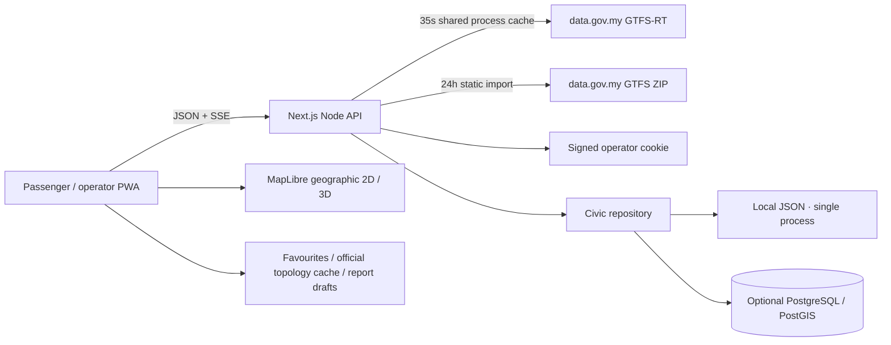

# GERAK ↗

**Malaysian mobility, with a voice for every neighbourhood.**

GERAK combines official Johor bus positions, a geographic 2D map, an animated miniature 3D city, route discovery and a shared passenger/operator civic-report workflow. It is a working CODEFEST MVP with documented production boundaries—not a claim of an audited transport service.

## Run locally

Requires Node.js **22+** and npm. Next.js **16.3.7**, React **19.3.0**, TypeScript, App Router.

```sh
npm ci
```

Copy `.env.example` to `.env.local` (`Copy-Item .env.example .env.local` in PowerShell), then:

```sh
npm run dev
```

Open [localhost:3000](http://localhost:3000). No paid map key or database is required. Johor opens in **official live mode**; the official static network imports automatically on first use. To prefetch it before presenting:

```sh
npm run ingest
```

For a local-only demonstration of operator actions, explicitly set `ALLOW_DEMO_OPERATOR=true`. Otherwise configure a random `AUTH_SECRET` of at least 32 characters and `OPERATOR_PASSWORD`. Public operational deployments must disable demo login and use HTTPS. Example configuration is not a production secret.

## What works

- **Real data:** BAS.MY Johor GTFS schedules, stops, route geometry and GTFS-Realtime vehicle positions from data.gov.my. Source timestamps and missing/stale data are visible. Live failures never silently substitute fake vehicles.
- **Passenger:** route/stop search, direct or one-transfer connections over published representative stop sequences, local favourites, BM/English UI, vehicle details and camera follow.
- **Maps:** MapLibre/OpenFreeMap geographic map; geographic 3D with OSM building extrusions and GPS-anchored bus models; smooth position/heading interpolation; selected-route filters; bounded markers; fleet-density heatmap; geographic fallback when WebGL/map resources fail.
- **Community:** geotagged categories, text, optional resized photo, local offline draft, server persistence and authenticated status lifecycle. No synthetic issue reports are seeded.
- **Operator:** current fleet, observation freshness, report inbox and lifecycle updates, snapshot-based analytics and explicitly simulated dispatch instructions.
- **PWA:** manifest, icons, production service worker, same-origin shell/assets caching, cached official route topology and offline fallback. Privileged API responses and map tiles are not cached by the service worker.
- **Backend:** bounded GTFS downloads and parsing, process cache/coalescing, SSE with polling fallback, validation, origin protection, signed HTTP-only sessions, process-local limits, structured feed logs and health endpoint.

## Source truth

See the in-app [source registry](http://localhost:3000/sources), [complete sources and APIs](docs/SOURCES.md), and [data availability register](docs/API_AND_DATA_SOURCES.md).

| Data | Reality |
| --- | --- |
| Johor positions, route IDs, GPS times | Official data.gov.my VehiclePosition feed |
| Johor routes/stops/shapes | Official GTFS Schedule ZIP; one representative trip per route |
| ETA / delays | National TripUpdates is not connected; no fabricated live arrivals or delay counts |
| Ride-time estimate | GERAK approximation from published representative route duration and stop order; excludes waiting/transfer time |
| Accessibility / occupancy / speed | Only supplied fields are trusted; absence is not a positive claim |
| 3D buildings and terrain | OSM building footprints with provider/estimated heights; real coastline and roads; no surveyed elevation terrain |
| UTHM | Explicit pilot simulation; existing KATSANA tracker researched, no authorised telemetry integration |
| Civic reports | Actual application records, not automatically sent to councils or emergency services |

The initial successful integration retrieved **75 real vehicle observations, 21 routes and 988 stops** on 30 September 2026. Counts change; these are historical verification observations.

The user-requested [Jalan KL](https://kl.jalanmalaysia.com/) and [Abeto Messenger](https://messenger.abeto.co/) guided the miniature-city presentation. No source code, models or artwork were copied.

## Commands

```sh
npm run typecheck       # TypeScript
npm test                # Transit, motion, feed, auth, civic lifecycle and SSE tests
npm run build           # Optimized production build
npm start               # Local production server
npm run ingest          # Fetch/import official Johor static GTFS
npm run poll -- --once  # Standalone feed probe; don't run parallel collectors in production
npm run db:migrate      # Optional PostgreSQL/PostGIS schema
npm run sources         # Regenerate the complete source/dependency inventory
npm run format:check    # Source formatting check
```

PWA behaviour requires a production build on localhost or HTTPS. A phone visiting an HTTP LAN address can use the web app, but may not be allowed to install/register a service worker.

## Architecture



Source layout: `src/app` pages/API routes; `src/components` UI/map renderers; `src/lib/server` ingestion/auth/storage; `db/schema.sql`; `scripts`; `tests`; `docs`.

## Deployment

The Dockerfile builds standalone Next.js output and runs as a non-root user. Compose includes PostGIS and persistent volumes. Configure `POSTGRES_PASSWORD`, `AUTH_SECRET`, `OPERATOR_PASSWORD` and `APP_ORIGIN`, then run `docker compose --env-file .env.local up --build -d`. Use HTTPS and `COOKIE_SECURE=true` at your production proxy. See [deployment instructions](docs/DEPLOYMENT.md).

Docker/PostGIS deployment has not been provisioned or integration-tested here. No public cloud deployment is claimed. Horizontal scaling requires a shared ingestion owner/cache, distributed rate limits and database-backed records. OIDC, object media storage/moderation, calendar-aware routing, surveyed buildings and real campus telemetry remain roadmap work.

## Project guide

| Document | Purpose |
| --- | --- |
| [MASTER_PLAN](docs/MASTER_PLAN.md) | Scope and acceptance gates |
| [ARCHITECTURE](docs/ARCHITECTURE.md) | Current and target diagrams |
| [SOURCES](docs/SOURCES.md) | All data, APIs, references and direct dependencies |
| [API_AND_DATA_SOURCES](docs/API_AND_DATA_SOURCES.md) | Malaysian feed capabilities and quotas |
| [RESEARCH_AND_INSPIRATION](docs/RESEARCH_AND_INSPIRATION.md) | Repository/design research |
| [API](docs/API.md) / [DATABASE](docs/DATABASE.md) | Contracts and schema |
| [CODEFEST_STRATEGY](docs/CODEFEST_STRATEGY.md) / [DEMO_SCRIPT](docs/DEMO_SCRIPT.md) | Presentation |
| [TESTING](docs/TESTING.md) / [PROGRESS](docs/PROGRESS.md) | Checks and actual verification status |
| [DEPLOYMENT](docs/DEPLOYMENT.md) / [ROADMAP](docs/ROADMAP.md) | Operations and remaining work |

The shared prior conversation and a separate CODEFEST judging brief were unavailable. The detailed user requirements guided implementation; no unseen rubric or partnership was assumed.
