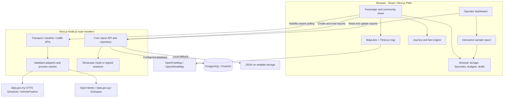
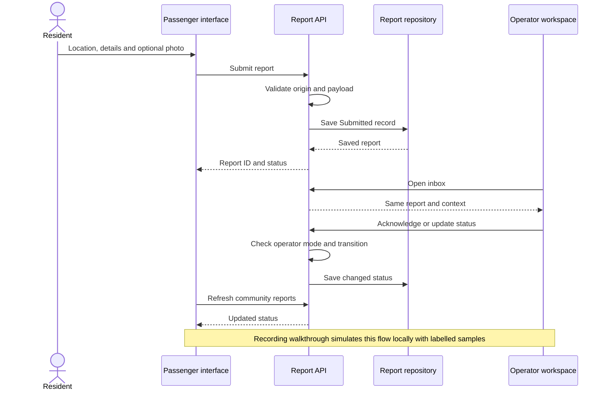

<p align="center">
  
</p>

# GERAK ↗

**One place to plan your journey, follow your bus, understand travel costs, and give your community a voice.**

**UTP CODEFEST 2026 · Track 3: Civic Tech · Mobility & Public Services**

**Made by [seladevs.my](https://seladevs.my).**

[Live application](https://gerak.seladevs.my) · [Journey planner](https://gerak.seladevs.my/plan) · [Operator dashboard](https://gerak.seladevs.my/operator) · [Recording demo](https://gerak.seladevs.my/operator?walkthrough=report) · [Data sources](https://gerak.seladevs.my/sources)

GERAK is a Malaysian mobility and civic-participation web application. It brings official transport data, geographic 2D/3D maps, journey connections, supported fare estimates, recurring travel budgets, and community reporting into a shared passenger/operator experience. Its central idea is simple: **the bus journey and the street around it belong in the same conversation.**

This repository contains the working hackathon MVP, APIs, tests, references and presentation materials. A labelled interactive recording demo also lets the team demonstrate one sample report from submission to operator response.

## Contents

- [Problem statement](#problem-statement)
- [Target audience](#target-audience)
- [How GERAK solves the problem](#how-gerak-solves-the-problem)
- [Features and implementation status](#features-and-implementation-status)
- [System architecture](#system-architecture)
- [Run the project](#run-the-project)
- [CODEFEST demonstration and submission](#codefest-demonstration-and-submission)
- [Impact, feasibility and roadmap](#impact-feasibility-and-roadmap)
- [Resources, references and credits](#resources-references-and-credits)

## Problem statement

A useful public-transport journey involves more than knowing a route number. A passenger needs to understand where the bus is, whether the information is recent, how to connect two stops, and what regular travel may cost. The walking route and boarding area matter too: a pothole, flooded path, damaged shelter or blocked ramp can make an otherwise usable journey difficult.

GERAK addresses three connected gaps:

1. **Transport information needs context.** Routes, stops, vehicle positions and source freshness should be understandable together, especially on an unfamiliar journey.
2. **Travel choices need cost information.** Riders need to compare available estimates and plan recurring costs without treating unavailable fares as free travel.
3. **Street-level feedback needs a visible response.** Residents need to describe a specific problem with a photo and location; operators need an organised inbox and a way to communicate progress.

Our problem hypothesis is that connecting these tasks can reduce planning effort and make local issues easier to report and follow. The MVP demonstrates that workflow. The pilot plan below explains how we would measure its benefit.

## Target audience

| Audience                                                         | Need                                                   | GERAK's response                                                                            |
| ---------------------------------------------------------------- | ------------------------------------------------------ | ------------------------------------------------------------------------------------------- |
| Daily commuters and bus-dependent residents                      | Understand routes, vehicle locations and travel costs. | Shared map, selected-bus follow, journey options and fare estimates.                        |
| University students and first-time riders                        | Learn a network and plan repeated journeys.            | Searchable stops, 2D/3D context, favourites and monthly projections.                        |
| Passengers with accessibility needs, older people and caregivers | Identify information gaps and report barriers.         | Available accessibility information, explicit unknown states and location-specific reports. |
| Residents around transport corridors                             | Make infrastructure problems visible.                  | Community reports with category, photo, details and status.                                 |
| Transport or campus operations teams                             | Review fleet observations and respond to issues.       | Operator dashboard, report inbox and management controls.                                   |
| Potential campus/local-service partners                          | Evaluate a bounded civic-tech pilot.                   | Demonstrable workflow, documented sources and a staged operating plan.                      |

These are intended users and potential pilot stakeholders, not a claim of adoption or an official partnership.

## How GERAK solves the problem

### See the journey

Choose a service area, explore its routes and stops, and select a vehicle. Official vehicle observations are shown where the upstream feed supplies them. Switch from a 2D overview to a close 3D Follow view while retaining the selected bus.

GERAK preserves GPS observation timestamps and distinguishes fresh, stale and unavailable information. Smooth movement between observations is an animation of received data, not a new GPS measurement.

### Compare available choices and plan costs

Choose an origin and destination to find direct or one-transfer connections over imported route patterns. Review available ride-time and fare estimates, including source/calculation explanations, then choose an option for your journey and budget.

Add a journey to **Saved → Transport budget**. Set the month, operating days, frequency, one-way/return assumptions and spending limit to view projected costs. Preferences and budgets stay in the browser.

The planner compares route connections rather than calendar-aware departures. Available fare values may include partial estimates, so their ordering does not guarantee the cheapest complete journey. Budget projections are planning aids, not ticket purchases or completed-spending records.

### Report a problem and follow the response

Select a location, choose a category, add a title and description, and optionally attach an image. The report becomes a community record that an operator can open and manage. The passenger view can then show its changed status:

**Submitted → Acknowledged → In progress → Resolved**

These are application workflow states. Reports are not automatically sent to a council or emergency service, and a status update alone does not prove that a physical repair happened.

## Features and implementation status

| Area                     | Implemented                                                                                                                         | Scope and boundaries                                                                                                      |
| ------------------------ | ----------------------------------------------------------------------------------------------------------------------------------- | ------------------------------------------------------------------------------------------------------------------------- |
| Official transport data  | GTFS Schedule and VehiclePosition adapters; routes, stops, geometry, vehicle identifiers and observation times.                     | Availability varies by service and operating hours; missing fields remain unknown.                                        |
| Geographic maps          | MapLibre/OpenStreetMap basemap, DOSM boundaries, 2D/3D, route filters, bus selection, Follow camera and fleet density.              | Buses are enlarged map symbols; building heights are provider-supplied or estimated, not a surveyed digital twin.         |
| Journey planning         | Stop/route search, direct and one-transfer connections, route-aware vehicle context and available fare ordering.                    | No calendar-aware departures, guaranteed arrival prediction or universal multi-operator itinerary.                        |
| Fares and budgets        | Supported BAS.MY distance rules, published Kuching route-table overrides, passenger preferences and recurring projections.          | Ambiguous/unsupported costs remain unavailable; operator fare tables prevail. Pass comparisons require verified coverage. |
| Civic reporting          | Geotagged categories, optional validated image, community view, operator edit/delete controls and status changes.                   | Real records depend on configured storage; no external authority integration.                                             |
| Operator workspace       | Fleet/freshness views, report inbox, snapshot analytics and simulated dispatch controls.                                            | Default shared showcase operator; simulated dispatch does not contact a driver.                                           |
| Recording walkthrough    | Pothole, shelter, flooding and access-ramp examples; editable form, photo capture, operator/passenger views, reset and persistence. | Labelled browser-local samples, separate from the real server inbox.                                                      |
| What If exploration      | Hypothetical stop closures and alternative boarding candidates where a connection exists.                                           | Scenario analysis, not an official closure or verified walking route.                                                     |
| Traffic context          | Singapore border camera snapshots, official Malaysian CCTV links and OSM signal-location adapter.                                   | Snapshots are not video; no live light phases/countdowns; upstream availability varies.                                   |
| Usability and resilience | Responsive web UI, light/dark appearance, BM/English interface, saved preferences, offline drafts and PWA shell.                    | Translation coverage is partial; offline access does not provide live tracking or guarantee report delivery.              |

### Service coverage

The registry includes nine BAS.MY cities—Johor Bahru, Kangar, Alor Setar, Kota Bharu, Kuala Terengganu, Ipoh, Seremban, Melaka and Kuching—plus KTMB and selected Prasarana services. Seremban combines two operator feeds. Rapid KL rail is schedules-only.

A service appearing in the selector does not establish current upstream availability. The dated [feed verification report](docs/FEED_VERIFICATION.md) records empty/unavailable endpoints, including conditions observed for Kangar and Rapid Kuantan. Its counts are historical, not today's fleet totals.

UTHM Parit Raja and Pagoh are pilot regions. The main campus experience uses geographic context with labelled simulation. Standalone telemetry adapter/worker tooling exists in [`worker/`](worker/README.md); that does not establish an authorised, deployed campus integration. See [UTHM pilot research](docs/UTHM_PILOT.md).

## System architecture

One Next.js application serves the passenger interface, operator workspace and server APIs. Pure TypeScript modules handle journey connections, fares and scenario comparisons. Server adapters validate and normalise external data before exposing it to the browser.



**Refresh:** the primary browser hook polls vehicles and reports, pausing in hidden tabs. Server caches, request coalescing and bounded downloads reduce duplicate upstream work. An SSE endpoint also exists at `/api/events`; the current main client uses polling.

**Storage:** with `DATABASE_URL`, reports use PostgreSQL/PostGIS. Otherwise they use JSON under `GERAK_DATA_DIR` or `.runtime`. Vercel's writable fallback is temporary and unshared across instances; use a database for durable, shared reports. The recording walkthrough uses browser storage independently.

**Access:** showcase mode supplies a shared demo operator without passwords or signing cookies. Protected mode uses expiring signed `HttpOnly`, `SameSite` sessions. Origin checks, schema validation and process-local rate limits remain in the API layer.

### Report workflow



### Technology stack

| Layer           | Main technologies                                                      |
| --------------- | ---------------------------------------------------------------------- |
| Application     | Next.js App Router, React, TypeScript, Node.js 22+                     |
| Maps/rendering  | MapLibre GL JS, Three.js, React Three Fiber/Drei, OpenFreeMap          |
| Data processing | GTFS-Realtime bindings, fflate, csv-parse, Zod                         |
| Persistence     | Browser storage, JSON, optional PostgreSQL/PostGIS                     |
| UI              | Custom CSS, Lucide icons, DM Sans and Space Grotesk                    |
| Verification    | Node test runner through tsx, TypeScript and production build          |
| Packaging       | Web manifest/service worker, standalone Next.js output, Docker/Compose |

Versions and reproducible installation are defined by [`package.json`](package.json) and [`package-lock.json`](package-lock.json).

## Run the project

### Development

Prerequisites: **Node.js 22+**, npm and internet access for maps/feeds. The default local demonstration needs no paid map key or database.

```sh
git clone https://github.com/hzqfarhan/SELADEVS-CIVICTECH-AND-PUBLICSERVICES.git
cd SELADEVS-CIVICTECH-AND-PUBLICSERVICES
npm ci
cp .env.example .env.local
npm run dev
```

On Windows PowerShell, replace the copy command with `Copy-Item .env.example .env.local`. Open [localhost:3000](http://localhost:3000). Johor requests official feeds; the static network imports on first use. Optional prefetch: `npm run ingest`.

### Operator configuration

The hackathon dashboard opens as **GERAK Demo Operator**. Anyone with site access can use operator actions while this showcase is enabled. No password or signing secret is required for that demonstration mode.

To restore restricted access, set **both** `OPERATOR_SHOWCASE_MODE=false` and `ALLOW_DEMO_OPERATOR=false`, then configure a random `AUTH_SECRET` of at least 32 characters and an `OPERATOR_PASSWORD`. Keep secrets in deployment settings or ignored environment files.

| Variable                            | Purpose                                                           |
| ----------------------------------- | ----------------------------------------------------------------- |
| `OPERATOR_SHOWCASE_MODE`            | Shared operator demonstration, enabled by default unless `false`. |
| `ALLOW_DEMO_OPERATOR`               | Separate demo-session login when showcase mode is off.            |
| `AUTH_SECRET` / `OPERATOR_PASSWORD` | Signing secret/password for protected mode.                       |
| `APP_ORIGIN`                        | Exact mutation-check origin, e.g. `https://gerak.seladevs.my`.    |
| `COOKIE_SECURE`                     | Set `true` for protected sessions over HTTPS.                     |
| `DATABASE_URL`                      | Enables PostgreSQL/PostGIS report storage.                        |
| `GERAK_DATA_DIR`                    | Persistent writable directory for single-host JSON storage.       |
| `NEXT_PUBLIC_MAPTILER_KEY`          | Optional browser key for satellite imagery.                       |

See [`.env.example`](.env.example). After configuring PostgreSQL, run `npm run db:migrate`.

### Verification and production

```sh
npm run typecheck
npm test
npm run build
npm start
```

The source baseline passed **98 automated tests** and a production build during operator/walkthrough verification on 21 October 2026. Coverage includes transit, fares, feeds, map motion, civic APIs, protected/showcase access and recording-demo state. These checks are engineering evidence, not a user study or a guarantee of upstream availability.

| Command                  | Use                                                          |
| ------------------------ | ------------------------------------------------------------ |
| `npm run ingest`         | Prefetch official Johor static GTFS.                         |
| `npm run fare:coverage`  | Inspect fare coverage.                                       |
| `npm run fares:build`    | Validate fare transcriptions and regenerate overrides.       |
| `npm run sources`        | Regenerate the source/dependency inventory.                  |
| `npm run poll -- --once` | Probe vehicle feeds; avoid duplicate independent collectors. |
| `npm run format:check`   | Check source formatting.                                     |

The [health endpoint](https://gerak.seladevs.my/api/health) exposes application/storage/feed context. See [deployment](docs/DEPLOYMENT.md), [database](docs/DATABASE.md) and [API contracts](docs/API.md). PWA installation/service-worker behaviour requires HTTPS or localhost.

## CODEFEST demonstration and submission

GERAK connects **mobility visibility, affordability and a resident-to-operator feedback loop**. The 3D presentation supports a practical task; the core demonstration should prove one journey and one report response.

### Try the prototype

1. Open [Live buses](https://gerak.seladevs.my/buses), select a service, inspect an available bus's source/GPS time, and show 2D overview and 3D Follow.
2. Open [Plan](https://gerak.seladevs.my/plan), use a supported stop pair, compare available connections/fare estimates, and save a journey to the [transport budget](https://gerak.seladevs.my/saved).
3. Open the [recording walkthrough](https://gerak.seladevs.my/operator?walkthrough=report). Choose an issue, snap the example photo, submit, acknowledge as operator, then show the passenger update. Use **Reset take** for another recording.
4. For a real application-record demonstration, use your test environment's Community form and Operator inbox with the same report ID. This is separate from the browser-local sample.

Keep live/demo, estimate and concept labels visible. An unavailable official feed should not be replaced by an unlabelled simulator.

### Presentation materials

| Material                              | Location and status                                                                                                                                                                                                                                                                    |
| ------------------------------------- | -------------------------------------------------------------------------------------------------------------------------------------------------------------------------------------------------------------------------------------------------------------------------------------- |
| Application and source                | [Live GERAK](https://gerak.seladevs.my) and this repository.                                                                                                                                                                                                                           |
| Existing three-minute prototype pitch | [180-second video](media/gerak-promo/hackathon/GERAK-Hackathon-Pitch-Female-1080p.mp4) · [production notes](media/gerak-promo/hackathon/README.md). Uses 20 October captures, synthetic narration and labelled examples.                                                               |
| Latest motion film and editing kit    | [Video repository](https://github.com/hzqfarhan/vdutp) · [complete editing ZIP](https://github.com/hzqfarhan/vdutp/raw/refs/heads/main/media/gerak-launch/team-edit/GERAK-Team-Storyboard-and-Edit-Package.zip), including narration-free visuals, music/effects, script and cut list. |
| Current team recording plan           | [78 seconds of motion + 102 seconds of system demonstration](https://github.com/hzqfarhan/vdutp/blob/main/media/gerak-launch/team-edit/GERAK-3min-Storyboard.md), with the team's own narration. This is separate from the existing synthetic-voice pitch.                             |
| Report recording instructions         | [Resident → operator → passenger guide](docs/RECORDING_WALKTHROUGH.md).                                                                                                                                                                                                                |
| Requirements review                   | [Audit against the supplied CODEFEST brief](docs/CODEFEST_GAP_ANALYSIS_2026-10-20.md).                                                                                                                                                                                                 |

### Submission handoff

The repository's requirements audit was prepared from the team's supplied brief screenshots. The [published CODEFEST page](https://utpcodefest.vercel.app/) establishes the societal-problem MVP context. Confirm final administrative details against the organisers' latest brief and submission portal.

- [x] Working prototype, source repository and setup instructions.
- [x] Problem, audience, solution, architecture and resource references.
- [x] Pitch/editing assets, storyboard and interactive recording support.
- [ ] Confirm the registered 3–4 member roster, student details and individual roles in the team slides.
- [ ] Link the final submitted team-voiced three-minute video and slide deck; existing video assets are listed above.
- [ ] Rehearse the primary flows in Bahasa Melayu/bilingual mode, including form errors and accessible labels.
- [ ] Verify judge access to submitted URLs and rehearse the selected build.
- [ ] For the finale, confirm the A1 poster, slides, working prototype, five-minute pitch and Q&A preparation against the supplied brief.

Structure the slides around six areas: **project/team; problem/track; solution/value; technical implementation; UX/design; feasibility/impact**. This README supplies project evidence; it does not imply that unlinked team deliverables have already been submitted.

## Impact, feasibility and roadmap

**Intended benefit.** Make travel information easier to interpret, recurring costs easier to plan, and local issues easier to report and follow. Mobile web delivery, BM/English controls and optional 2D presentation support an initial pilot without requiring a native application installation.

**Proposed pilot.** Start with one corridor/campus and an identified operations team. Recruit 5–10 consenting riders and 1–2 operational stakeholders, agree on data/report ownership, and evaluate the actual build. These are proposed participants, not existing users.

| Question                             | Evidence to collect                                                         |
| ------------------------------------ | --------------------------------------------------------------------------- |
| Can riders find a useful route/bus?  | Task success and time, including a Bahasa Melayu task.                      |
| Is location information trustworthy? | Fresh/stale/unavailable observations over a defined period.                 |
| Can residents report a barrier?      | Submission success, time and assistance needed.                             |
| Can operators respond?               | Submission-to-acknowledgement time with durable timestamps.                 |
| Do fare tools help understanding?    | Correct interpretation of estimates, unknown fares and monthly projections. |

Compare with a baseline and report the sample, dates and limitations. No measured reduction in waiting, emissions, spending or repair time is claimed by this MVP.

**Delivery path.** Complete BM coverage and validate the workflow with users. Add accountable response notes/history, structured stop/route context and further accessibility checks. Broader deployment needs durable storage, individual operator roles, moderation/media retention, monitoring and shared ingestion/cache/rate limits. Current caches and limits are process-local.

Nearby resident notifications, council/Open311 interoperability, validated live arrivals and native iOS/Android experiences remain proposed work. Campus telemetry tooling needs an authorised integration and deployment validation before being presented as the main app's live campus feed.

See the [roadmap](docs/ROADMAP.md), [Civic Tech gap analysis](docs/CODEFEST_GAP_ANALYSIS_2026-10-20.md) and [cross-platform plan](docs/CROSS_PLATFORM_IMPLEMENTATION_PLAN.md).

## Resources, references and credits

### Data and geography

| Resource                                                                                                                                                    | Use in GERAK                                                                               |
| ----------------------------------------------------------------------------------------------------------------------------------------------------------- | ------------------------------------------------------------------------------------------ |
| [data.gov.my GTFS Schedule](https://developer.data.gov.my/realtime-api/gtfs-static)                                                                         | Official Malaysian routes, stops and trip geometry.                                        |
| [data.gov.my GTFS-Realtime](https://developer.data.gov.my/realtime-api/gtfs-realtime)                                                                       | Official VehiclePosition observations; no TripUpdates/service-alert integration claimed.   |
| [BAS.MY fares and passes](https://bas.my/pasperjalanan.php)                                                                                                 | Published fare rules and eligibility information.                                          |
| [LPKP Sarawak Q05 fare publication](https://www.lpkpsarawak.gov.my/wp-content/uploads/2025/09/q05.pdf) and [`data/fare-tables/`](data/fare-tables/)         | Published Kuching tables; each transcription retains its source URL and verification date. |
| [DOSM open geodata](https://github.com/dosm-malaysia/data-open/tree/main/datasets/geodata)                                                                  | Malaysian state/district context.                                                          |
| [OpenFreeMap](https://openfreemap.org/quick_start/), [OpenMapTiles](https://openmaptiles.org/) and [OpenStreetMap](https://www.openstreetmap.org/copyright) | Basemap, roads and building footprints, with attribution.                                  |
| [Open-Meteo](https://open-meteo.com/en/docs)                                                                                                                | Weather context at the selected service-area centre.                                       |
| [LTA traffic images via data.gov.sg](https://data.gov.sg/datasets/d_6cdb6b405b25aaaacbaf7689bcc6fae0/view)                                                  | Periodic Singapore border-area camera snapshots.                                           |
| [Overpass API](https://wiki.openstreetmap.org/wiki/Overpass_API)                                                                                            | Community-mapped signal junction locations, subject to availability.                       |
| [UTHM transportation](https://www.uthm.edu.my/en/transportation)                                                                                            | Campus research/existing tracker context; no partnership implied.                          |

Further provenance: [live registry](https://gerak.seladevs.my/sources), [`src/lib/sources.ts`](src/lib/sources.ts), [source inventory](docs/SOURCES.md), [data capability register](docs/API_AND_DATA_SOURCES.md), [fare details](docs/FARES_AND_BUDGET.md) and [traffic details](docs/TRAFFIC_IMPLEMENTATION.md). Dated checks are historical observations.

### Engineering and design

- [GTFS Schedule](https://gtfs.org/documentation/schedule/reference/) and [GTFS-Realtime](https://gtfs.org/documentation/realtime/reference/) specifications; [MobilityData bindings](https://github.com/MobilityData/gtfs-realtime-bindings).
- [Next.js](https://nextjs.org/docs), [React](https://react.dev/), [MapLibre GL JS](https://maplibre.org/maplibre-gl-js/docs/) and [Three.js](https://threejs.org/docs/) documentation.
- [OneBusAway](https://github.com/OneBusAway/onebusaway-application-modules) and [OpenTripPlanner](https://github.com/opentripplanner/OpenTripPlanner) informed transit architecture research. [FixMyStreet](https://github.com/mysociety/fixmystreet) and [Open311](https://wiki.open311.org/GeoReport_v2/) informed civic-reporting research; they are not connected authority services in this MVP.
- [Jalan KL](https://kl.jalanmalaysia.com/) and [Abeto Messenger](https://messenger.abeto.co/) were experiential references. GERAK's meshes and illustrations were made for this project. See [research and inspiration](docs/RESEARCH_AND_INSPIRATION.md).

Provider data, maps, fonts and dependencies retain their respective licences/terms. This repository does not currently declare a standalone application source-code licence; public visibility does not imply one. Media production notes identify generated narration and original audio/visual assets where applicable.

### Repository guide

| Path                           | Purpose                                                                  |
| ------------------------------ | ------------------------------------------------------------------------ |
| `src/app/`                     | Pages and API route handlers.                                            |
| `src/components/`              | Passenger/operator UI, maps and recording walkthrough.                   |
| `src/lib/` / `src/lib/server/` | Transit, fares, scenarios, data hooks, adapters, access and persistence. |
| `data/` / `db/`                | Geographic/fare source material and database schema.                     |
| `scripts/` / `tests/`          | Ingestion, tooling and automated verification.                           |
| `worker/`                      | Separate campus telemetry worker.                                        |
| `media/gerak-promo/`           | Pitch films and production materials.                                    |
| `docs/`                        | Architecture, APIs, research, deployment and presentation evidence.      |

**Made by [seladevs.my](https://seladevs.my).**

GERAK — _Your city. Your voice. Your next move._
