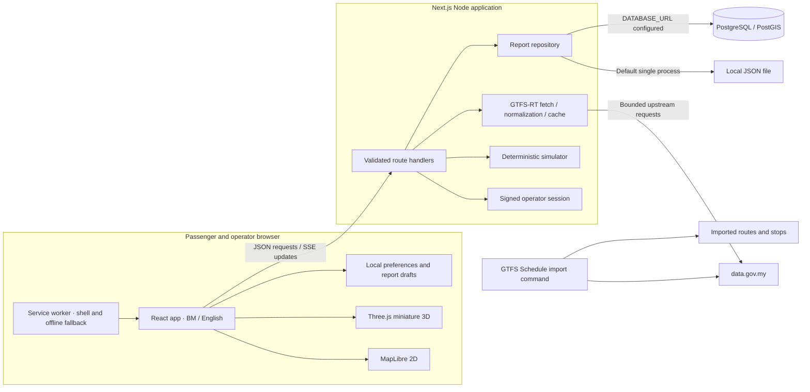
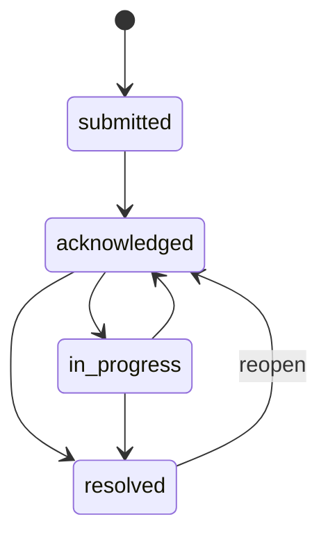
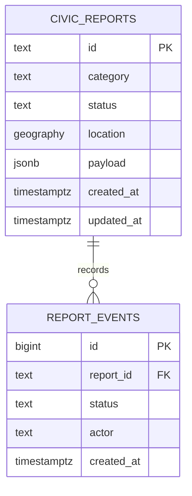
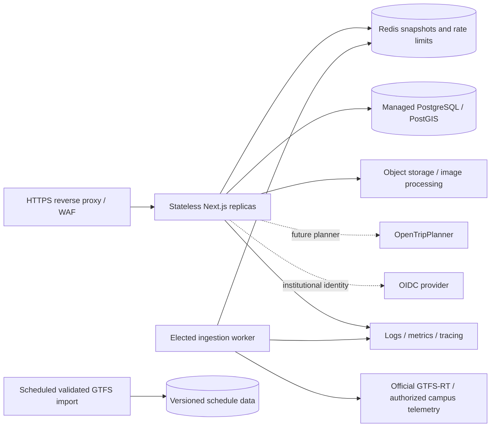

# Architecture

## Runtime and boundaries

GERAK uses **Next.js App Router, TypeScript and React**, with Node route handlers. The initial dependency resolution uses Next.js **16.3.7** and React **19.3.0**; `package-lock.json` is the reproducible authority. MapLibre supplies the geographic map and Three.js/React Three Fiber supplies the miniature experience. Shared contracts are in `src/lib/types.ts`.

The simulator and official transport adapter are distinct sources. The browser consumes normalized vehicle snapshots with source, update time and staleness information. Civic records use a server repository; favourites and interface preferences belong to the browser. The backend also exposes `/api/events`: named `vehicles` and changed `reports` events are checked every five seconds, each connection closes after 55 seconds, and the stream suggests a three-second reconnect interval.

## Transport model

`Coordinate` is `[longitude, latitude]`. Routes have geographic paths, stop IDs, region, operator and source. Vehicles preserve ID, route ID, position, heading, observation timestamp and source. The shared `VehicleSnapshot` indicates whether it contains official GTFS-RT or simulator records.

The seed network consists of **illustrative** Johor corridors and a separate UTHM pilot. Its topology, duration, accessibility attributes, occupancy and delays are demonstration data. A deterministic clock-based function produces stable vehicle identities and route progress. The demo ETA calculates remaining loop progress plus synthetic delay; it is an estimate. The planner returns direct or one-transfer options over the selected network. Official mode respects representative official stop ordering; duration is a proportional running-time estimate excluding waiting. It is not timetable-aware. Cross-region planning is deliberately rejected.

Official vehicle positions remain authoritative. The renderer must not snap an unmatched official vehicle to a synthetic route. Absent occupancy, accessibility, service alerts or arrival predictions must remain unknown in the user interface. See `API_AND_DATA_SOURCES.md` for the actual official feed capabilities and quota.

The implemented adapter coalesces concurrent requests in one process, refreshes no faster than every 35 seconds, uses an eight-second upstream timeout and marks a snapshot stale after 90 seconds relative to its newest observation. Each vehicle retains its own timestamp. A failed refresh keeps the last official observations if available; otherwise it returns an empty official snapshot with an unavailable notice. The cache and quota coordination are not shared between Node processes.

`/api/network` automatically downloads and persists official Johor GTFS to `.runtime/network.json`, refreshing after 24 hours. Failures retain cached official data or return empty official topology. UTHM remains an explicitly illustrative pilot. Live is the default; simulation requires explicit selection.

## Motion and map rendering

Motion state is separate from React view state. Successive snapshots update interpolation targets; animation reads the motion state each frame. Simulated vehicles interpolate route progress using cached segment distances so corners stay on the displayed route. Official fixes interpolate coordinates with a bounded interval. Bearings interpolate through the shortest angle. Old targets settle rather than extrapolating forever.

The two map modes have independent renderers with shared selection/motion contracts. The 2D map uses MapLibre 6 with OpenFreeMap's dark vector style and the provider's OpenMapTiles/OpenStreetMap attribution. `scripts/prepare-assets.mjs` copies the matching MapLibre worker to the local public assets during install, development and build, avoiding an external worker CDN and retaining version compatibility. The miniature scene uses a latitude-aware local geographic projection around the selected region and original procedural buildings, trees and roads. This provides the small-world visual requested by the user without implying surveyed buildings. It caps pixel ratio at 1.5, uses instancing for bounded building/tree populations and a single shadow light. These choices are performance measures, not measured phone frame-rate guarantees.

Map selection and vehicle identity live in the parent application so switching modes preserves context. A geographic SVG schematic supports vehicle/stop selection and geotagging without WebGL or basemap access; a failed 3D context falls back through the 2D path. Real terrain and surveyed buildings are not implemented.

## Civic persistence and authentication

Public submissions are validated with Zod. Coordinates are bounded to the supported Malaysian area; text lengths and request sizes are bounded. Optional PNG/JPEG/WebP data URLs are checked for allowed type, size and file signature. Signature checks are a first line of validation, not a malware scanner or complete image decoder.

Without `DATABASE_URL`, the repository uses `GERAK_DATA_DIR/reports.json` or `.runtime/reports.json`. Writes are serialized within one process and replace the file through a temporary file. This is useful for local development, **not shared storage for multiple replicas**. With PostgreSQL configured, report locations are PostGIS points and status changes use a row-locking transaction. Production media should move from inline report payloads to an object store.

The wire value for `in_progress` above is `in-progress`. Repeating the current status is allowed. A direct submitted-to-resolved jump is rejected. These statuses describe GERAK's workflow, not confirmed municipal work.

Operator authentication uses an HMAC-signed, expiring HTTP-only cookie. Demo sessions are controlled by `ALLOW_DEMO_OPERATOR`; production uses configured credentials and a sufficiently long `AUTH_SECRET`. Mutation guards check origin and operator session; rate limiting is process-local. The current credential model is suitable for a bounded pilot, not institutional identity governance.

## Database design

`db/schema.sql`, applied by `npm run db:migrate`, is the implementation authority. Its core report model is:

The payload preserves the API representation; explicit category/status/timestamp columns support queries and constraints. A geographic index supports future proximity and jurisdiction queries. The schema also prepares `transit_routes`, `transit_stops`, `vehicle_observations` and `pilot_devices`; the MVP importer/collector writes files and does **not** populate those prepared transit tables. Future transit persistence should namespace agency/feed/trip identifiers, version imported schedules, retain original observation times and partition position history by time. Do not imply that proposed historical analytics or campus device authentication are already operating.

## Production growth path

Redis, elected scheduling, OIDC, an OTP deployment, media scanning, automated backups and production monitoring are **hardening work**, not services silently provided by `npm run dev`. A single Node container is the first deployable topology. See `DEPLOYMENT.md` for release gates and `UTHM_PILOT.md` for the proposed authorized campus telemetry boundary.

## Geographic 3D update — 30 September 2026

The active 3D mode now shares the MapLibre geographic basemap with 2D, replacing the procedural miniature city described in earlier sections. OpenFreeMap/OpenStreetMap supply real Johor coastline, roads and building footprints. Extrusions use provider render heights or an estimated minimum height, not surveyed elevation. GPS-anchored bus footprints animate with observed headings; model size is exaggerated at regional zoom for readability. The MY overview control frames Johor, while follow zooms to the selected bus. Sources: https://openfreemap.org/quick_start/ and https://maplibre.org/maplibre-gl-js/docs/examples/display-buildings-in-3d/. A Johor Bahru z14 tile was verified to contain 70 building features, 7 water features and 1,140 transportation features.

## Nationwide expansion — 1 October 2026

The endpoint registry in src/lib/feeds.ts replaces the Johor-only adapter scope described in older sections. All documented BAS.MY cities, both Seremban operators, KTMB and four Prasarana bus categories are registered. Prasarana rapid-rail-kl is static-only. Vehicle and network caches are isolated by endpoint; IDs are namespaced outside legacy Johor. Unique static trip-ID suffix matching resolves Prasarana variants when the route ID is absent/unmatched. All adapters share the process-level four-request/minute budget. The verification report records 29 successful HTTP responses out of 31 checks, 398 imported routes and 15,532 stops, alongside upstream gaps. See FEED_VERIFICATION.md and SOURCES.md.
