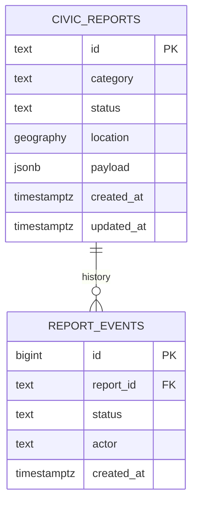

# Storage and database

The default local demo persists civic reports in `.runtime/reports.json`, or `GERAK_DATA_DIR/reports.json`. It starts with two explicitly labeled demonstration reports. Serial writes and atomic file replacement prevent lost updates inside one Node process. Reads contain public report data and optional images. The local repository is bounded to 2,000 reports and public listing returns the latest 500. Back up the persistent directory if those records matter. Never share this repository across processes or place it on an ephemeral serverless filesystem.

## PostgreSQL/PostGIS setup

1. Provision a PostgreSQL database with the PostGIS extension available.
2. Set `DATABASE_URL` in `.env.local` or the process environment.
3. Run `npm run db:migrate`; the script loads `.env.local` and applies `db/schema.sql` in a transaction.
4. Start GERAK and submit a report. Confirm its status can be changed after operator login.

If the migration role cannot create extensions, an administrator must enable PostGIS first. Use a separate least-privilege application role after migration. Connection strings and credentials belong in a secret manager, never in source. The application uses parameterized `postgres` queries, a connection pool limited to five and a ten-second connection timeout. A configured but unavailable database produces API errors; the application does not silently split writes into local storage.

No running PostgreSQL service is provisioned by `npm install`. The repository tests exercise the file repository; the actual migration and PostgreSQL transaction paths require an integration database before deployment. Existing JSON records are not automatically imported when `DATABASE_URL` is enabled. The database starts empty rather than inserting demonstration reports.

## Implemented civic tables

| Table | Purpose | Constraints and indexes |
| --- | --- | --- |
| `civic_reports` | Current report and complete JSON API payload | Text primary key; category/status checks; geographic GiST index; status/time index |
| `report_events` | Operator status history | Identity key; report foreign key; timestamp |

`civic_reports.location` is `geography(Point,4326)` constructed in longitude/latitude order. Explicit category/status/timestamp columns support filtering while the JSON payload preserves the API representation, including location label and optional inline image. Status updates lock the report row inside a transaction, validate its current transition, update its payload and append an event. The MVP event actor is the shared string `operator`; individual account attribution needs institutional identity integration. Local JSON status updates do not maintain a separate audit event table.

## Prepared transit schema

`transit_routes`, `transit_stops`, `vehicle_observations` and `pilot_devices` describe the future persistent ingestion boundary. The executable MVP importer writes `network.json`; the optional collector writes `vehicles.json`. These scripts do **not** populate the prepared tables. The running app currently reads its own cached GTFS-RT feed; it does not consume `vehicles.json`. Do not run the collector alongside app live polling against the same upstream quota.

Before using these tables operationally, introduce namespaced feed IDs, versioned schedules, trips/calendars/stop times, observation retention/partitioning and a sole ingestion worker. The `pilot_devices` table alone does not implement a GPS ingestion endpoint or device authentication.

## Release validation

- Apply the idempotent schema twice in staging and confirm no data loss.
- Submit a geotagged report; verify `ST_X(location::geometry)` and `ST_Y(location::geometry)` match the request.
- Race two status transitions against the same report and verify row locks preserve valid lifecycle ordering.
- Restart the app and verify reports persist; rehearse backup restore separately.
- Disable database access and confirm visible API failures rather than silent local writes.
- Validate storage growth, media retention and migration procedure with representative traffic.

See `ARCHITECTURE.md` and `DEPLOYMENT.md` for the Redis, media storage, identity and monitoring work required beyond the single-process MVP.
