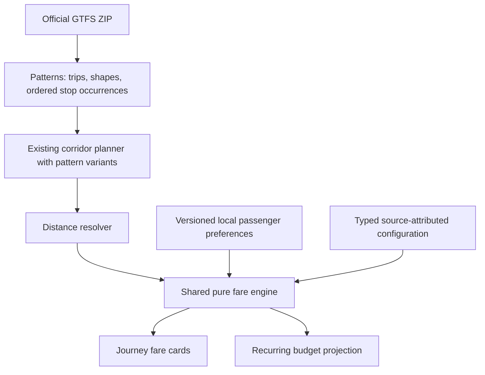

# Fare estimation and transport budgets

Implemented after Phase 0 approval, 8 October 2026. The passenger interface uses a navy/blue theme. Map lighting starts at night and only changes through the manual night/day/dusk control. Weather remains informational.

## Access
Open the journey planner, choose stops and calculate a connection. Passenger profile preferences sit above results. Each result has leg-level fare explanations and **Add to monthly budget**. Open **Saved** for the budget. Set a month, spending limit, journeys per day, operating days and one-way/return travel. New recurring trips start with zero operating days; GERAK does not assume a work calendar. Return counts represent complete outbound/return pairs. Each direction is priced independently.

## Data flow

No additional dependencies, backend endpoints or database migrations. Civic reporting and telemetry storage are unchanged.

## File map
- `src/lib/types.ts`: optional TripPattern metadata on existing routes.
- `src/lib/server/gtfs-static.ts`: retain directional patterns, original shape points, stop occurrence sequences and raw shape-distance values. Units default to unknown rather than guessed metres.
- `src/lib/server/network.ts`: endpoint namespace propagation and version-2 cache refresh. Old cache data can still display routes, but cannot manufacture a fare.
- `src/lib/transit.ts`: planner considers distinct patterns while retaining the existing route IDs and corridor-planning contract.
- `src/lib/fares.ts`: typed validated configuration, geometry/distance resolution, leg mapping, deterministic monetary calculation and partial journey totals.
- `src/lib/transport-budget.ts`: validated recurring journeys, independent return resolution, monthly projection and dated pass comparison.
- `src/lib/fare-preferences.ts`: schema-versioned local restoration; malformed/obsolete data returns safe defaults.
- `src/lib/fare-copy.ts`: English/Malay strings.
- `src/components/fare-budget.tsx`: passenger selector, result explanation, budget editor and local preference hook.
- `src/components/gerak-app.tsx`: planner and Saved integration.
- `src/lib/sources.ts`: BAS.MY source attribution.
- `tests/fares-budget.test.ts`: fare/distance/import/planner/budget/persistence/render integration cases.
- Theme changes: `globals.css`, `transport-map.css`, map palette, map/boundary/fleet/building/bus components, vehicle picker, layout, manifest and app icons.

## Monetary policy
Use integer millionths of RM for tariff arithmetic, then round half up to integer sen after the applicable concession. Accumulate monthly totals only in sen. This is an **estimation policy**, not a claim about operator rounding.

Formula examples: 2 km = RM0.94; 2.1 km = RM1.03; 5 km = RM1.22; 10 km = RM1.69. The originally supplied RM1.04/RM1.23 examples conflict with nearest-sen rounding and were corrected in the approved proposal. Half-price 10 km is RM0.85.

Precedence: validate operator/configuration/date → applicable exact route table → distance rule → eligible concession where allowed → final rounding. A known route table without a matching segment blocks generic fallback. Unsupported or invalid configurations do not become free fares. Free-card ownership/active coverage is explicitly self-declared, never described as operator verification.

## Distance integrity
Preferred: same-pattern stop-time shape-distance subtraction with known units, valid stop ordering and monotonic distances. Current imported units remain unknown until independently established. Fallback: project ordered stops onto the full original GTFS shape, within 40 metres, rejecting competing alignments and wrong order; sum along-shape metres. Repeated boarding/alighting stop IDs are conservatively unavailable because the current stop-selection UI does not disambiguate occurrences. Missing shape geometry, demo corridors and straight-line stop connectors are never fare distances. Display-simplified geometry and GPS animation predictions are never used.

The planner remains a corridor planner, not a schedule-aware booking system. It does not guarantee a particular departure or operate across service regions. Calendars are not used for budget projections; operating days are the user's explicit assumptions.

## Source verification and remaining limits
Official source checked during Phase 0 on 8 October 2026: https://bas.my/pasperjalanan.php . Rates: RM0.94 first 2 km + RM0.094 per additional kilometre or part. RM30 for 30 days is the published Malaysian-citizen pass price. The page distinguishes senior card eligibility (60+) from half-price single fares (>60). Route tables displayed in buses remain authoritative.

- Only BAS.MY Peninsular service regions receive the general configuration; Kuching remains unverified. Prasarana, KTMB and UTHM remain unsupported for monetary estimates.
- No actual route-specific fare tables have been obtained/mapped. Override support is implemented and tested, not populated with invented values.
- City-specific pass coverage is **not confirmed**. The UI therefore explains why comparisons cannot yet be offered. The comparison engine and UI support verified configuration, explicit travel dates and activation day once evidence is supplied.
- Comparison retains uncovered costs and observes the 30-day window. Mixed fares use chronological selected occurrences, grouping legs into journeys. Negative savings are not advertised as savings. Zero-fare travel never produces a fabricated break-even.
- Initial audit DNS lookup failed, but final production verification successfully refreshed the official Johor static feed on 8 October 2026. All 21 routes now retain trip patterns. Of 40 patterns checked at their first segment, 18 passed the conservative distance checks. Cached data without patterns remains unavailable until re-import succeeds.
- Actual-spend transactions are deferred as approved; planned journeys are never labelled completed transactions.

## Persistence and privacy
`gerak:fare-profile:v1` and `gerak:transport-budget:v1`, both versioned and Zod-validated. No identity documents, date of birth, credentials or precise location are collected. Budget calculations remain on the device. Only selected service-region network requests go to the existing API. Removed route/pattern/stop references remain saved and prompt re-planning. Computed prices are not persisted as authoritative fares.

## Verification
65 tests passed during implementation, including SSR fare-display integration using React's existing renderer. TypeScript passed. Production build and visual verification status are recorded in PROGRESS.md. `format:check` initially identified existing formatting issues as well as touched files; touched files were subsequently formatted. No lint script exists.

Further operator support requires published fare tables, trip/shape mappings, operator entitlement rules, transfer rules, pass coverage and validity evidence. Do not enable rules solely because an operator name resembles another configured service.

