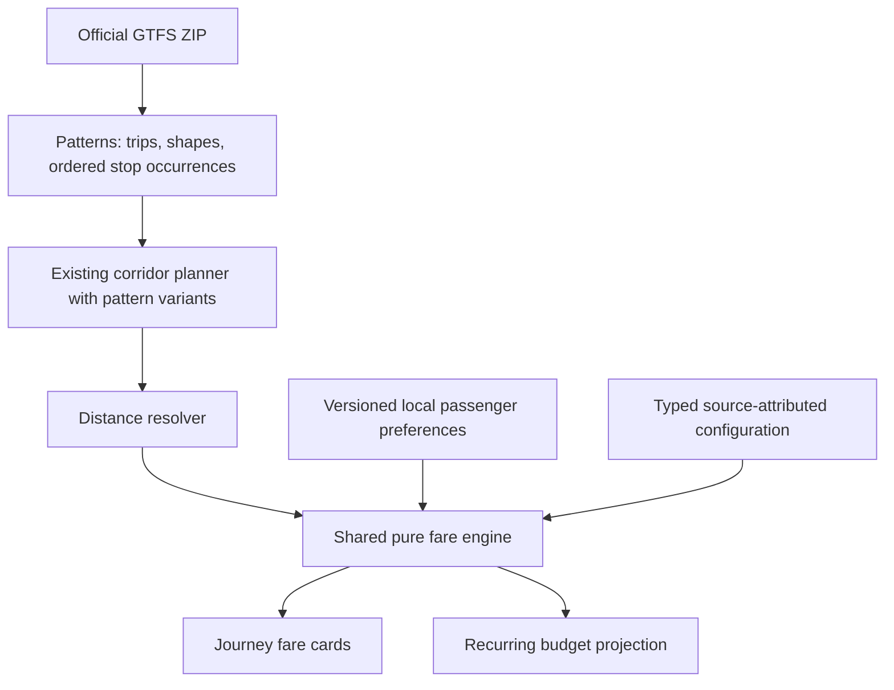

# Fare estimation and transport budgets

Implemented after Phase 0 approval, 8 October 2026. The passenger interface uses a navy/blue theme. Map lighting starts at night and only changes through the manual night/day/dusk control. Weather remains informational.

## Access

Open the journey planner, choose stops and calculate a connection. Passenger profile preferences sit above results. Each result has leg-level fare explanations and **Add to monthly budget**. Open **Saved** for the budget. Set a month, spending limit, journeys per day, operating days and one-way/return travel. New recurring trips start with zero operating days; GERAK does not assume a work calendar. Return counts represent complete outbound/return pairs. Each direction is priced independently.

## Data flow

No additional dependencies, backend endpoints or database migrations. Civic reporting and telemetry storage are unchanged.

## File map

- `src/lib/types.ts`: optional TripPattern metadata on existing routes.
- `src/lib/server/gtfs-static.ts`: retain directional patterns, original shape points, stop occurrence sequences and raw shape-distance values. Units default to unknown rather than guessed metres.
- `src/lib/server/network.ts`: endpoint namespace propagation and version-2 cache refresh. Old cache data can still display routes, but cannot manufacture a fare.
- `src/lib/transit.ts`: planner considers distinct patterns while retaining the existing route IDs and corridor-planning contract.
- `src/lib/fares.ts`: typed validated configuration, geometry/distance resolution, leg mapping, deterministic monetary calculation and partial journey totals.
- `data/fare-tables/`: transcriptions of published operator fare-table posters with source attribution.
- `scripts/build-fare-overrides.ts`: validates tables against the GTFS networks and regenerates `src/lib/fare-overrides.generated.json` (`npm run fares:build`).
- `src/lib/transport-budget.ts`: validated recurring journeys, independent return resolution, monthly projection and dated pass comparison.
- `src/lib/fare-preferences.ts`: schema-versioned local restoration; malformed/obsolete data returns safe defaults.
- `src/lib/fare-copy.ts`: English/Malay strings.
- `src/components/fare-budget.tsx`: passenger selector, result explanation, budget editor and local preference hook.
- `src/components/gerak-app.tsx`: planner and Saved integration.
- `src/lib/sources.ts`: BAS.MY source attribution.
- `tests/fares-budget.test.ts`: fare/distance/import/planner/budget/persistence/render integration cases.
- Theme changes: `globals.css`, `transport-map.css`, map palette, map/boundary/fleet/building/bus components, vehicle picker, layout, manifest and app icons.

## Monetary policy

Use integer millionths of RM for tariff arithmetic, then round half up to integer sen after the applicable concession. Accumulate monthly totals only in sen. This is an **estimation policy**, not a claim about operator rounding.

Formula examples: 2 km = RM0.94; 2.1 km = RM1.03; 5 km = RM1.22; 10 km = RM1.69. The originally supplied RM1.04/RM1.23 examples conflict with nearest-sen rounding and were corrected in the approved proposal. Half-price 10 km is RM0.85.

Precedence: validate operator/configuration/date → applicable exact route table → distance rule → eligible concession where allowed → final rounding. A known route table without a matching segment blocks generic fallback. Unsupported or invalid configurations do not become free fares. Free-card ownership/active coverage is explicitly self-declared, never described as operator verification.

## Distance integrity

Preferred: same-pattern stop-time shape-distance subtraction with known units, valid stop ordering and monotonic distances. Imported units are inferred only when a pattern's complete, monotonic `shape_dist_traveled` magnitudes match its shape polyline; otherwise they remain unknown. Fallback: assign every stop between boarding and alighting to strictly increasing points on the full original GTFS shape by minimising total snap error, preferring stops within 40 metres and consulting the 40-80 m band only for stops that have nothing closer, then accept the distance only when all near-optimal assignments place each stop in one along-shape cluster; genuine ties and wrong order fail closed. Repeated boarding/alighting stop IDs are conservatively unavailable because the current stop-selection UI does not disambiguate occurrences. Missing shape geometry, demo corridors and straight-line stop connectors are never fare distances. Display-simplified geometry and GPS animation predictions are never used.

The planner remains a corridor planner, not a schedule-aware booking system. It does not guarantee a particular departure or operate across service regions. Calendars are not used for budget projections; operating days are the user's explicit assumptions.

## Source verification and remaining limits

Official source checked during Phase 0 on 8 October 2026: https://bas.my/pasperjalanan.php . Rates: RM0.94 first 2 km + RM0.094 per additional kilometre or part. RM30 for 30 days is the published Malaysian-citizen pass price. The page distinguishes senior card eligibility (60+) from half-price single fares (>60). Route tables displayed in buses remain authoritative.

- Only BAS.MY Peninsular service regions receive the general distance formula. Kuching/Sarawak has no verified formula publication, so its configuration carries `formulaVerified: false`: Kuching legs price only through imported route tables, and the national RM30 pass price is withheld there (`pass.priceSen: null`). Prasarana, KTMB and UTHM remain unsupported for monetary estimates.
- Route fare tables are ingested from published operator posters, never invented: `data/fare-tables/*.json` holds the transcription with source URL and verification date; `npm run fares:build` (`scripts/build-fare-overrides.ts`) validates each direction against the imported GTFS network and emits `src/lib/fare-overrides.generated.json`. Two direction formats exist: `matrix` (full between-stop table; poster stops map positionally as for Q05, or by explicit `gtfsStopId` subset where the poster lists stops the current pattern lacks, with `gtfsStopId: null` excluding those pairs) and `terminal` (linear terminal→destination table, boarding at the pattern's first stop). Rows must be dimensionally correct and monotonic, and stop order must not diverge from GTFS. When two tables price the same pair, the newer `sourceDate` wins.
- As of 18 October 2026 the populated Kuching tables are Q01, Q05, Q06, Q07, Q08, Q09 and Q10 (2,840 segments total). Where a route has both a 14 May 2025 between-stop matrix and Sept 2025 linear terminal rows, the two are cross-checked: they agree on every comparable pair for Q08 outbound (8/8), Q10 outbound (11/11) and Q10 inbound (6/7), so the matrix is trusted for the pairs the poster does not name and the later poster wins where they differ. The May Q08 **inbound** matrix is the exception — it contradicts the current poster on all eight comparable pairs (Terminal Bas Bau → Steesen Bas Saujana RM4.00 vs RM3.80) — and is therefore excluded outright rather than used for unsampled pairs; those legs report `unresolved_override`.
- Both the May matrices and the Sept 2025 posters already sit below the pre-reduction fares: the 10 March 2025 LPKP press statement documents the new schedule effective 11 March 2025 (Open Air Market → Pusat Jantung Sarawak RM2.30, → Unimas Hospital RM2.70, → Siburan RM4.00), and each of those values is reproduced by both documents.
- Ambiguous poster stops (e.g. Q06 inbound "BATU 4", Q09 "LEMBAGA LADA MALAYSIA") are excluded fail-closed, as are poster stops absent from GTFS (Q08 "DATO TAWI SLI"/"PASAR BAU BYPASS", Q10 "WISMA SEBERKAS"/"UNIMAS"). Q05's outbound pattern has no GTFS shape at all, so its table is the only way it can ever be priced. Q02-Q04 have posters but no GTFS routes; Q11-Q16 publish route maps and timetables but no fare table; those corridors stay `unverified_city`.
- City-specific pass coverage is **not confirmed**. The UI therefore explains why comparisons cannot yet be offered. The comparison engine and UI support verified configuration, explicit travel dates and activation day once evidence is supplied.
- Comparison retains uncovered costs and observes the 30-day window. Mixed fares use chronological selected occurrences, grouping legs into journeys. Negative savings are not advertised as savings. Zero-fare travel never produces a fabricated break-even.
- Initial audit DNS lookup failed, but final production verification successfully refreshed the official Johor static feed on 8 October 2026. All 21 routes now retain trip patterns. Of 40 patterns checked at their first segment, 18 passed the conservative distance checks. Cached data without patterns remains unavailable until re-import succeeds.
- 18 October 2026: the Johor feed publishes `shape_dist_traveled` on none of its 76,930 stop-time rows, so distance-unit inference cannot help it; the windowed monotonic projection assignment (`npm run fare:coverage`) raises sampled stop-pair priceability from 50.2% to 92.6%, with the remainder still failing as ambiguous shapes.
- 18 October 2026 Phase 3 re-import refreshed all BAS.MY caches to schema v2 with trip patterns. Sampled-pair coverage: Johor 92.6%, Ipoh 90.8%, Seremban A/B 93.5/99.8%, Melaka 95.6%, while Kangar 42.4%, Alor Setar 43.0%, Kota Bharu 48.9%, Kuala Terengganu 46.3% and Kuching 43.3% are capped by feeds whose trips omit shape geometry (half their patterns have no `shapes` reference). No BAS.MY feed publishes usable `shape_dist_traveled` values (Melaka has the column but every row is empty), so the distance-formula path stays geometry-projection-only until operators publish richer data or route fare tables.
- Snap tolerance is tiered, not widened: a stop within 40 m of its own shape is used as before, and the 40-80 m band is consulted only when nothing is closer (`SNAP_TRUSTED`/`SNAP_RELUCTANT` in `src/lib/fares.ts`). Real feeds plot some stops across a forecourt or slip road - KTM Kulai sits 45-60 m from its terminal apron in both Johor patterns - and a wider band could otherwise introduce rival candidates for stops that already snapped well. The near-optimal cluster gate is unchanged and still has the final say. Measured on 18 October 2026 with `scripts/fare-coverage.ts` (sampled stop pairs): Johor 92.6% → 93.5% (+46 pairs), Kuala Terengganu 46.3% → 47.2% (+24), every other city unchanged and none regressed; city-wide 72.6% → 72.8%.
- Residual Johor failures after that change are 310 pairs, and they are all genuine geometric ties: 219 where two shape passes both claim the stop and no signal separates them (median tie 850 m apart, p90 4.2 km, i.e. a coin-flip would misprice a leg by RM0.08-RM0.40), and 91 where the stop lies to the left of exactly one pass. Under Malaysia's left-hand-traffic convention a boarded stop sits on the left of its own traversal, which would resolve those 91 to about 95.4% - deliberately **not** adopted, because it is a road-rule convention rather than published fare or geometry evidence. If it is ever enabled it needs its own reason string so inferred geometry is never presented like verified geometry.
- Actual-spend transactions are deferred as approved; planned journeys are never labelled completed transactions.

## Persistence and privacy

`gerak:fare-profile:v1` and `gerak:transport-budget:v1`, both versioned and Zod-validated. No identity documents, date of birth, credentials or precise location are collected. Budget calculations remain on the device. Only selected service-region network requests go to the existing API. Removed route/pattern/stop references remain saved and prompt re-planning. Computed prices are not persisted as authoritative fares.

## Verification

65 tests passed during implementation, including SSR fare-display integration using React's existing renderer. TypeScript passed. Production build and visual verification status are recorded in PROGRESS.md. `format:check` initially identified existing formatting issues as well as touched files; touched files were subsequently formatted. No lint script exists.

Further operator support requires published fare tables, trip/shape mappings, operator entitlement rules, transfer rules, pass coverage and validity evidence. Do not enable rules solely because an operator name resembles another configured service.
