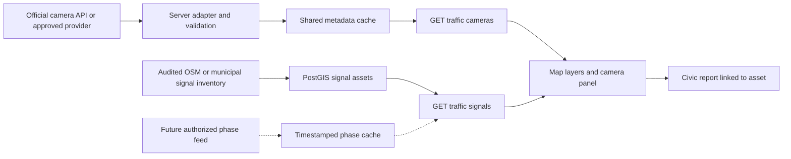

# Traffic lights, CCTV and map refinement plan

Research date: 8 October 2026. This is a researched implementation plan; no camera stream or live signal integration has been added. Existing vehicle GTFS feeds do not supply camera video or traffic-light phases.

## Decision

Implement three separate capabilities: (1) mapped signal locations, (2) traffic-camera views, (3) live signal state only if an authorized, documented feed becomes available. Start with Johor and a clearly labelled Singapore border-camera supplement. Keep the blue/night design and do not add more permanent labels to the map.

## Source assessment

| Source | Verified evidence | GERAK use | Remaining gate |
| --- | --- | --- | --- |
| [MBJB i-Trafik](https://itrafik.mbjb.gov.my/itrafik/list_cctv) | Public camera directory lists Jalan Skudai, Wong Ah Fook/JBCC, Jalan Tebrau and Jalan Jim Quee/CIQ, among others | First-choice Johor camera discovery and official-view links | Camera playback, coordinates, refresh interval and embedding/reuse permissions not verified; no documented API found in pages reviewed |
| [MBJB terms](https://itrafik.mbjb.gov.my/itrafik/terma_syarat) | General portal terms, no explicit open-media licence found in reviewed text | Record terms alongside source registry | Do not treat publicly viewable media as a verified redistribution API |
| [DBKL KLCCC](https://klccc.dbkl.gov.my/) and [DBKL service description](https://www.dbkl.gov.my/perkhidmatan-dalam-talian/klccc) | Official pages advertise public CCTV views and traffic-light monitoring | KL expansion; official-view fallback | No public signal phase/countdown API or supported media API verified |
| [LLM camera page](https://www.llm.gov.my/cctv1/get_traffic_cctv) | Current indexed page directs users to Tuju for full CCTV views | Highway source link pending supported integration | Do not build against historical scraped camera endpoints |
| [data.gov.sg Traffic Images](https://data.gov.sg/datasets/d_6cdb6b405b25aaaacbaf7689bcc6fae0/view) | Documented public API; image URLs, coordinates, camera IDs and timestamps; Open Data Licence | Earliest API-backed image viewer, explicitly Singapore/border coverage | Verify image load and attribution in implementation; metadata availability alone is not playback testing |
| [OneMotoring traffic cameras](https://onemotoring.lta.gov.sg/content/onemotoring/home/digitalservices/view-traffic-cameras.html) | Official named views include Woodlands and Tuas | Validate camera names/directions | Match IDs to authoritative labels; do not infer exact camera direction from coordinates alone |
| [OSM traffic signals](https://wiki.openstreetmap.org/wiki/Traffic_light) | Community mapping represents signal-controlled junctions; not necessarily individual poles | Static location layer and civic issue anchors | Audit local completeness and duplicates; preserve OSM attribution/licence requirements; surveyed pole positions required for exact 3D placement |
| [MyGOS traffic_light FeatureServer](https://mygos.mygeoportal.gov.my/gisserver/rest/services/Hosted/traffic_light/FeatureServer) | Search-discovered service only; direct metadata retrieval failed | Candidate for later validation | Coverage, ownership, schema, freshness and reuse terms unverified; not an approved data dependency |
| [Malaysian GTFS-RT documentation](https://developer.data.gov.my/realtime-api/gtfs-realtime) | Vehicle positions documented | Keep vehicle movement independent | No inference of actual red/green state from bus speed |

The [MBJB 2022 annual report](https://www.mbjb.gov.my/sites/default/files/inline-files/laporantahunanmbjb2022.pdf) describes CCTV/SCATS operations. This is historical evidence of municipal capability, not proof of a current public API.

### API observation

Read-only request to `https://api.data.gov.sg/v1/transport/traffic-images` returned eight camera records in the response inspected, including coordinates and per-image timestamps of 2026-10-08T17:05:25+08:00. This is a point-in-time result obtained through web retrieval, not a nationwide coverage or ongoing uptime claim. Documentation recommends requests every minute. Treat imagery as periodically updated snapshots, not continuous video. Do not hard-code eight cameras or promise all Singapore roads.

## Refined product experience

- Replace scattered controls with one Layers button: Buses, Routes, Cameras, Signals, Civic. Buses remain the primary layer. Cameras/signals start off, persist user preferences and display a concise source legend.
- At regional zoom show only uncluttered bus/group symbols. Cameras appear only when enabled; signal locations appear at street zoom (initial threshold 15, tune after phone testing). Show names only on selection. Selected bus always wins visual priority.
- Camera selection opens one panel: camera name, country/provider, observation time in MYT, image or authorized video, freshness, refresh state and Open official view. Only one active video player on phones; pause when hidden or offscreen. Never autoplay a grid of streams.
- A 3D signal is a neutral, unlit locator until live phase data is available. Do not place a pole precisely at an abstract OSM junction point; use a junction marker unless an audited pole location/bearing exists. Any illustrative animated signal belongs only in explicit demo mode.
- Bus following keeps its current camera angle when opening a traffic card; user can choose “Inspect location” to leave follow. Preserve a one-tap return to bus. Avoid camera movement from background refreshes.
- Add a quiet route context strip: nearby cameras, reported barriers, data age. Do not translate a camera image or a stopped bus into a numeric traffic-delay estimate.
- Label fields in BM/English: Kamera trafik / Traffic cameras; Lokasi lampu isyarat / Signal locations; Keadaan langsung tidak tersedia / Live state unavailable. Freshness must use text as well as colour.

## Architecture

Use the existing Next.js server and Zod validation; add a shared production cache before multiple instances. One refresh job per provider, deduplicate concurrent fetches, obey provider intervals, retry with backoff and honour Retry-After. Initial Singapore metadata TTL: 60 seconds; provisional stale threshold: 5 minutes, configurable after feed observation. A successful fetch does not make an old image fresh. No phase extrapolation after expiry.

Proposed records:

- `traffic_sources`: provider, coverage, sourcePage, licenceUrl, accessMode (link/snapshot/stream), refreshPolicy, verifiedAt, permissionStatus.
- `traffic_cameras`: namespaced ID, coordinate nullable, coordinateProvenance, country, road, viewingDirection nullable, provider ID, approved media type, enabled.
- `camera_observations`: camera ID, observedAt nullable, fetchedAt, upstream reference, availability. Persist metadata initially; no video archive.
- `signal_assets`: namespaced ID, junction/pole distinction, geometry, orientation nullable, source, sourceVersion, surveyedAt nullable.
- `signal_observations` (future): asset/approach ID, phase, observedAt, validUntil, source, confidence. Unknown is a first-class state.
- Civic reports link asset type/ID and keep the submitted location/source version for audit.

Proposed endpoints:

- `GET /api/traffic/cameras?bbox=...&provider=...`: bounded validated query; attribution, media capability and availability included.
- `GET /api/traffic/cameras/:id`: selected camera metadata and allowed viewer reference; no user-supplied upstream URL.
- `GET /api/traffic/signals?bbox=...`: static features plus nullable observations; never fabricate current phase.

Prefer licensed direct image loading when permitted. If a media proxy is needed, it must use a server-owned host/ID allowlist, validate redirects and private-IP targets, enforce byte/time limits and obey caching/reuse terms. Do not proxy arbitrary URLs or bypass blocked embedding. Expiring tokens remain server-side. Official links remain useful when playback fails. No face recognition, plate tracking, stored footage or remote signal control in this scope.

## Delivery sequence

### Phase 1 — Interface and capability foundation (estimate: 2–3 development days)

Build the Layers control, provider registry, freshness states and one camera detail panel. Add official MBJB/DBKL/LLM links without claiming embedded feeds. Import a reviewed Johor signal inventory, with static markers only. Signal import can ship independently of camera permissions; unknown coordinates stay list-only.

Exit: no bus-selection regressions, keyboard-operable controls, no overlapping labels, honest disabled/link-only providers.

### Phase 2 — First real camera integration (estimate: 2–3 days)

Implement the documented Singapore image API adapter and border filter; verify camera labels and attribution. Show captured timestamps and unavailable/stale images. Test iOS Safari and Android, then add approved Malaysian viewers when technical and reuse checks pass. Do not hold the useful snapshot feature hostage to an unavailable video stream.

Exit: real images load, only selected media fetched, stale data never labelled live, fallback official links work. Border imagery is clearly Singapore-side, not advertised as Johor city CCTV.

### Phase 3 — Civic connection (estimate: 3–5 days)

Add report types for signal malfunction, pedestrian-button failure, damaged crossing and obscured signal. Prefill selected asset/location, show nearby duplicate reports and distinguish community claims from verified faults. Operator gets asset/route/district filters and resolution evidence. Do not label a camera offline because its view is temporarily blocked or a signal broken merely because a user reports it.

Exit: report → acknowledgement → repair evidence is auditable; no automatic external council submission.

### Phase 4 — Authorized live signal pilot (external dependency)

Obtain documented read-only municipal/UTHM feed, approach-level mapping, timing semantics and freshness guarantees. Start with a small audited junction set; hide countdown unless validity is explicit. Do not stop or accelerate real tracked buses based on decorative signal states. Timing/ETA effects require separate validation against observed trips.

No duration committed until an actual feed and receiving owner exist. A partnership request can be drafted later; none has been sent.

## Verification and rollout

Unit tests: provider normalization, invalid coordinates/URLs, missing timestamps, stale thresholds, refresh deduplication, bbox bounds and rejected proxy targets. Integration tests: 429/backoff, timeouts, revoked media URL, image replaced by HTML, unavailable provider and offline recovery. Browser checks: 2D/3D layer toggles, selecting a bus under camera markers, one phone player, dark mode, BM/English, screen readers, no layout overflow and 30fps target on a representative ordinary phone (target, not measured result).

Feature flags: traffic cameras, static signals, live phases independent and default off until each gate passes. Provider-specific disable switch and cache invalidation support rollback. Existing fleet, fares and civic reports must remain usable with all traffic sources offline.

## Next recommended increment

Ship the Layers control + one timestamped border snapshot viewer + verified static Johor signal markers + official MBJB camera links. Then connect malfunction reporting. This yields a credible demo without pretending to have live Malaysian signal phases or unrestricted CCTV access.
